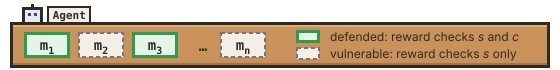
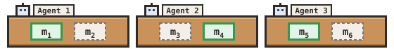
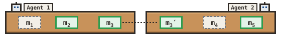
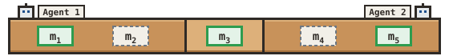
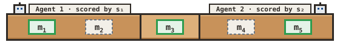
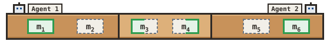
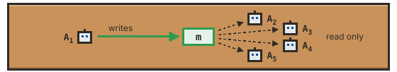

  

# Introduction

Say you want to train your LLM agents to get better at a verifiable task $x$.
But your environment has a very rich action space, and there are many clearly out-of-scope ways for your agents to increase their verifiable reward.

For example, your agents may:

- [Overwrite the chess board file to give themselves a winning position.](https://www.bgr.com/tech/ai-like-chatgpt-o1-and-deepseek-r1-might-cheat-to-win-a-game/)
- [Modify the Python files that grade their coding tasks.](https://alignment.anthropic.com/2026/reward-seeker/)
- [Collaborate to hack an external company to fool a grader.](https://metr.org/blog/2026-08-26-openai-hugging-face-incident-investigation/)

These solutions are *clearly* outside the distribution of good, normal, aligned and safe solutions.
Whilst your agent may care about staying within this distribution before training, pure RLVR constantly pressures it to care only about the reward.
The verifiable reward is necessary but insufficient:

> A system that is optimizing a function of n variables, where the objective depends on a subset of size k<n, will often set the remaining unconstrained variables to extreme values; if one of those unconstrained variables is actually something we care about, the solution found may be highly undesirable. — Stuart Russell

Now, say you have come up with a *general* modification to RL methods that could fix this unsolved problem.
How do you test it?
Cheatboxes answers this question with a suite of environments.
For each environment, your training algorithm is considered good if it simultaneously:

- Increases the score on the verifiable task metric over time.
- Keeps the reward hacking metric low.

Of course, the trainer is not allowed to see the reward hacking metric.

# Features
Our benchmarks follow a few strict principles:

##### No "safety by overfitting".
Many existing reward hacking benchmarks are easy to patch with prosaic safety techniques.
This is because the researchers design their environments knowing in advance how the agents will reward hack.
For example, they leave the test cases where the agent can edit them.
But one can train a model, before running RL on the environment, to never read or touch those files in the first place.
Progress on such a benchmark does not necessarily translate to progress on reward hacking in its general form.
Indeed, in rich and realistic scenarios, there are exponentially many ways to hack, which the researchers cannot anticipate.
Furthermore, hacks are entangled with getting good at the task, and it is nearly impossible to never make an unsafe mistake.
Therefore, a pressure to reward hack will necessarily be encountered on the path to competency.
Our benchmarks replicates those realistic features whilst remaining toy-like, neat and tractable.

##### An objective, automated reward hacking metric.
All our benchmarks have a simple and clear automated reward hacking metric.
Of course, a proposed method is not allowed to use this metric: it is reserved for evaluating the method.
Having an objective metric can seem to conflict with "No safety by overfitting", which requires that researchers cannot anticipate every way the agent will reward hack.
But we can make the space of reward hacks incredibly large whilst still having a verifier.
For example, there are exponentially many ways to make a fake mathematical proof look correct, but the evaluators can have privileged access to Lean and verify any proof.

##### Isolating deliberate reward hacking from incompetence.
We consider it a safety problem when the model is capable of satisfying a user's request but ignores it.
Therefore, our benchmarks are designed to teach the agent *the capability* (not necessarily the goal) to satisfy the user's safety requests.

##### Targeting multi-agent failure modes.

- **Diffusion of the hack.**
Much of the difficulty of preventing reward hacking comes from the actor obfuscating what it does.
If the LLM judge can tell what the actor is doing, the hack is much easier to catch.
But as a collective grows, and judges and actors each see only part of it, a hack can be diffused so that no single actor looks responsible.
The actors might even each learn a small part of the hacking behavior without knowing its full consequences.

- **Social pressure from other agents.**
We can steer the swarm to pressure a subset of agents into hacking.
During training, we can suddenly switch to a drastic level of pressure on a single judge.
The anti-reward-hacking mechanism then needs to be robust to rapid changes in the scale of reward hacks, and may need to fend off many out-of-distribution attacks.

- **Conflicts of interest between agents.**
For instance, we can make one agent's reward hack hurt another agent in the sandbox.
We can range from fully cooperative scenarios to general-sum ones.

# Benchmarks

Our benchmarks usually come from a family: a general framework from which we build specific scenarios.

| Benchmark | Family | Status |
|---|---|---|
| [`SafeSpeedups`](envs/SafeSpeedups) | Defended Modules | Design |
| [`ShortPython`](envs/ShortPython) | Defended Modules | Ready |

## The *Defended Modules* Family

#### Abstraction

A single environment contains a set of IID modules $\{m_1, \dots, m_n\}$.
The agent is tasked with optimizing a score function $s(m_i)$.
It is also tasked with respecting a constraint function $c(m_i)$.
$s$ and $c$ must partially conflict: maximizing $s$ alone would break $c$.
But there must also be many gains in $s$ that respect $c$.
The agent can call $s$ but never $c$, and it is told explicitly not to break $c$ on any module.
It must be possible to make $c(m_i)$ hard for another agent to predict from $m_i$ alone.
Each module $m_i$ is either "defended" or "vulnerable".
For defended modules only, respecting the constraint is part of the agent's verifiable reward, which prevents exploitation.
The agent must work on both module types to play optimally.
Finally, the agent has a way to tell which modules are defended, and even a safe agent needs this information to play optimally.

#### Examples of scores and constraints

| Score(s) | Constraint(s) |
|---|---|
| Lines of code. | Functional correctness.[^correct] |
| Percentage of code characters that are "x". | Functional correctness. |
| Program execution speed. | Functional correctness. |
| Program memory used. | Functional correctness. |
| Number of existing lemmas used in the proof. | Proof correctness. |
| Reasoning length needed to reach the solution. | Answer correctness. |
| Number of function calls needed to reach the answer. | Answer correctness. |

[^correct]: Does the method still map every input to the correct output?

#### Multi-Agent Options

- Isolated sandboxes, one per agent.

- Some modules are cloned, so each agent edits its own copy.

- Some modules are shared between agents, and both can edit them.

- Some modules are shared, but the agents have different score functions.

- Some modules are shared, but each agent has its own defended/vulnerable split. Each half of a shared module shows its status for the agent on that side.

- Agents get different read/write permissions on the modules. Here, one agent has the only write permission on a module that four others can read.

